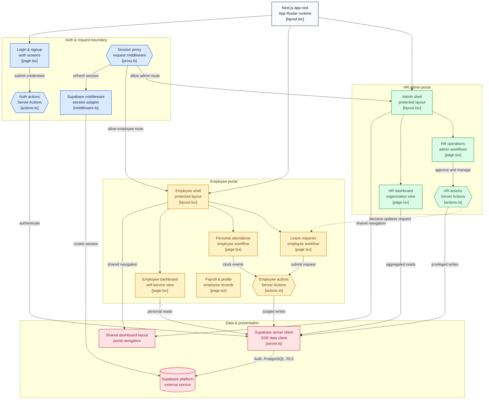

# Dayflow — Enterprise Human Resource Management System

<p align="center">
  <strong>Every workday, perfectly aligned.</strong>
  <br />
  A centralized platform for modern workforce management.
</p>

<p align="center">
  
  
  
  
  
  
</p>

<p align="center">
  
  
  
</p>

---

## Overview

**Dayflow** is a modern Human Resource Management System (HRMS) designed to digitize and streamline essential workforce management operations through a unified, role-based platform.

Built with Next.js, TypeScript, and Supabase, Dayflow brings employee administration, attendance tracking, leave management, and payroll operations into a centralized environment.

The platform follows a role-oriented architecture with dedicated interfaces for Employees and HR Administrators. Each role operates within its own access-controlled environment, ensuring that users interact only with the functionality and information relevant to their responsibilities.

Rather than treating HR operations as disconnected modules, Dayflow brings these workflows together into a consistent application experience.

### Project Objectives

- Centralize employee information and essential HR operations.
- Simplify daily attendance recording and workforce monitoring.
- Digitize leave application, review, and approval workflows.
- Provide employees with self-service access to their records.
- Establish secure role-based access boundaries between employees and administrators.
- Build a maintainable and extensible architecture suitable for future enhancements.

---

## Core Features

Dayflow is organized around five primary functional areas.

### 1. Authentication & Role-Based Access Control

A dedicated authentication and authorization layer separates employee functionality from privileged administrative operations.

**Key Capabilities**

- **Dual-Portal Architecture:** Separate application experiences and protected routes for `Employee` and `HR / Admin` roles.
- **Role-Based Authorization:** Access restrictions based on authenticated user roles.
- **Protected Administrator Onboarding:** HR account creation requires a server-side `ADMIN_SECRET`, preventing unauthorized administrative registration.
- **Session Persistence:** Supabase Authentication maintains authenticated sessions through secure HTTP-only cookies.
- **Route Protection:** Next.js middleware-based routing guards manage access to protected application routes.

### 2. Interactive Dashboards

Role-specific dashboards provide users with a centralized overview of relevant workforce information.

**Employee Dashboard**
- Personal profile overview.
- Attendance statistics and current-day status.
- Leave balance and request-related information.
- Quick access to frequently used HR operations.
- Recent activity and notification feed.

**HR Administrator Dashboard**
- Organization-wide employee statistics.
- Workforce attendance overview.
- Pending leave application summaries.
- Centralized access to administrative operations.

### 3. Attendance Management

The attendance module provides a structured workflow for recording and monitoring employee working hours.

**Employee Capabilities**
- Daily check-in and check-out functionality.
- Timestamp-based attendance recording.
- Current-day attendance status indicators.
- Personal attendance information.

**Administrator Capabilities**
- Centralized access to company-wide attendance records.
- Organization-wide daily attendance monitoring.
- Workforce activity visibility through administrative interfaces.

### 4. Leave & Time-Off Management

Dayflow implements a structured leave application and approval pipeline connecting employee requests with HR administrative decisions.

**Employee Capabilities**
- Submit leave applications through a self-service interface.
- Select leave categories: Paid, Sick, and Unpaid.
- Specify leave start and end dates.
- Include optional remarks with applications.
- Access previously submitted requests and their statuses.

**HR Administrator Capabilities**
- View organization-wide leave applications.
- Review pending employee requests.
- Approve or reject leave applications.
- Manage leave requests through a centralized administrative interface.

### 5. Payroll & Employee Profile Management

The payroll and profile modules provide access to employee records and compensation-related information.

**Employee Capabilities**
- View registered personal information.
- Access individual profile details.
- View compensation history.
- Access mock PDF payslip views.

**HR Administrator Capabilities**
- Access the organization-wide employee directory.
- View employee information.
- Manage salary structures through administrative controls.

---

## Technology Stack

Dayflow uses a modern full-stack JavaScript architecture, combining a server-rendered application framework, strongly typed development, reusable UI components, and a managed PostgreSQL backend.

| Layer | Technology | Purpose |
|---|---|---|
| Frontend Framework | Next.js 16 | Application framework and routing |
| Programming Language | TypeScript | Type safety and maintainable development |
| Application Architecture | App Router | File-system-based application routing |
| Server Logic | Server Actions | Server-side application operations |
| Styling | Tailwind CSS v4 | Utility-first styling |
| UI Components | shadcn/ui | Reusable interface components |
| Icon Library | Lucide React | Interface iconography |
| Authentication | Supabase Auth | User authentication and session management |
| Database | PostgreSQL | Relational data persistence |
| Database Platform | Supabase | Managed database and authentication infrastructure |
| Security | Row Level Security | Database-level access control |
| Build Tooling | Turbopack | Development and build tooling |
| Deployment | Vercel | Application hosting and deployment |

### Architectural Approach

The application follows a modular architecture that separates authentication, employee operations, administrative workflows, and data access.

**1. Presentation Layer**

- Role-specific dashboards and application interfaces.
- Shared layout components and navigation.
- Reusable UI components.

**2. Application Logic Layer**

- Server Actions for authentication and business operations.
- Employee-specific operations and workflows.
- Administrative operations with privileged access.

**3. Authentication & Authorization Layer**

- Supabase authentication.
- Session management through HTTP-only cookies.
- Middleware-based route protection.
- Role-specific access restrictions.

**4. Data Layer**

- Supabase server-side client.
- PostgreSQL database.
- Row Level Security policies.
- Server-side data access.

### Application Architecture



---

## Security & Access Control

Security is an important consideration in Dayflow's application architecture. The platform combines authentication, application-level route protection, and database-level access controls.

### Authentication

Supabase Auth handles user authentication and session management. Authenticated sessions are maintained using secure HTTP-only cookies.

### Role-Based Access

The application separates employee and administrator experiences through role-specific routes and protected layouts.

### Server-Side Operations

Server Actions handle sensitive application operations and provide a centralized location for server-side business logic.

### Database Security

PostgreSQL Row Level Security (RLS) provides database-level access control, allowing data access policies to be enforced at the database layer.

### Administrative Registration

Administrator account creation requires a server-side secret configured through the `ADMIN_SECRET` environment variable.

---

## Local Development Setup

Follow the instructions below to configure and run Dayflow in a local development environment.

### Prerequisites

Ensure the following tools and services are available:

- Node.js
- npm
- Git
- A Supabase account and project

### 1. Clone the Repository

```bash
git clone https://github.com/ritam-05/dayflow-hrms.git
cd dayflow-hrms
```

### 2. Install Dependencies

Install the project dependencies using npm.

```bash
npm install
```

### 3. Configure Environment Variables

Create a `.env.local` file in the root directory of the project.

Configure the following environment variables:

```env
NEXT_PUBLIC_SUPABASE_URL=your_supabase_project_url

NEXT_PUBLIC_SUPABASE_ANON_KEY=your_supabase_anon_key

ADMIN_SECRET=your_secure_admin_secret
```

**Environment Variable Reference**

| Variable | Description |
|---|---|
| `NEXT_PUBLIC_SUPABASE_URL` | URL of the Supabase project |
| `NEXT_PUBLIC_SUPABASE_ANON_KEY` | Supabase public/anonymous client key |
| `ADMIN_SECRET` | Server-side secret required for administrator account creation |

**Important Configuration Notes**

- Obtain the Supabase URL and client key from your Supabase project settings.
- Replace all placeholder values with valid credentials.
- Use a strong, unique value for `ADMIN_SECRET`.
- Never expose server-side secrets through client-side code.
- Do not commit `.env.local` or other files containing secrets to version control.

### 4. Start the Development Server

Run the following command:

```bash
npm run dev
```

Open the application in your browser:

[http://localhost:3000](http://localhost:3000)

The application will automatically redirect unauthenticated users to the login interface.

---

## Deployment

### Production Deployment with Vercel

Dayflow is configured for deployment on Vercel, with Supabase providing the database and authentication infrastructure.

**Deployment Procedure**

1. Push the application code to a GitHub repository.
2. Log in to [Vercel](https://vercel.com/).
3. Select **Add New Project**.
4. Import the Dayflow GitHub repository.
5. Configure the required environment variables under the project settings.

   ```env
   NEXT_PUBLIC_SUPABASE_URL=your_supabase_project_url
   NEXT_PUBLIC_SUPABASE_ANON_KEY=your_supabase_anon_key
   ADMIN_SECRET=your_secure_admin_secret
   ```

6. Initiate the deployment by selecting **Deploy**.
7. Once the build completes successfully, access the application through the production URL generated by Vercel.

**Deployment Dependencies**

| Service | Responsibility |
|---|---|
| Vercel | Application hosting and deployment |
| Supabase Auth | User authentication and session infrastructure |
| Supabase PostgreSQL | Application data storage |
| Supabase RLS | Database-level access policies |

---

## Project Structure

The application follows a modular directory structure that separates authentication, employee workflows, administrative functionality, reusable components, and backend integrations.

```text
dayflow/
├── app/
│   ├── (auth)/             # Authentication routes (Login, Signup)
│   ├── admin/              # HR-exclusive routes
│   │   ├── attendance/     # Global attendance logs
│   │   ├── dashboard/      # HR metrics overview
│   │   ├── employees/      # Company-wide personnel directory
│   │   ├── leave/          # Leave request approval queue
│   │   └── payroll/        # Salary structure management
│   ├── employee/           # Employee-exclusive routes
│   │   ├── attendance/     # Personal clock-in/out
│   │   ├── dashboard/      # Personal overview and alerts
│   │   ├── leave/          # Leave application form and history
│   │   ├── payroll/        # Salary history and payslips
│   │   └── profile/        # Personal details view
│   ├── auth/               # Server actions for Supabase Auth handling
│   ├── layout.tsx          # Root layout and global font configuration
│   └── globals.css         # Tailwind directives and custom scrollbars
├── components/
│   ├── layout/             # Application shell, responsive sidebar, headers
│   └── ui/                 # Reusable shadcn/ui primitives
├── lib/
│   └── supabase/           # Supabase SSR client configurations
└── middleware.ts           # Edge middleware for route protection and redirects
```

---

## Future Enhancements

The current implementation establishes the core HRMS workflows. The following enhancements represent potential extensions to improve automation, reporting, and organizational capabilities.

| Enhancement | Description | Proposed Technology |
|---|---|---|
| Advanced Analytics | Interactive visualizations for attendance trends, workforce statistics, and leave distributions. | Recharts |
| Automated Payslip Generation | Generate downloadable PDF payslips and deliver them to employees through email. | react-pdf |
| Bulk Employee Onboarding | CSV-based employee import pipeline for large-scale organizational onboarding. | CSV Processing |
| Shift Scheduling | Calendar-based shift allocation and working-hour management across departments. | Calendar Integration |
| Email Notifications | Automated notifications for leave approvals, rejections, and important HR updates. | Resend / SendGrid |

These enhancements are intended to extend the existing modular architecture without disrupting the core employee and administrator workflows.

---

## Project Information

| Attribute | Details |
|---|---|
| Project Name | Dayflow |
| Category | Human Resource Management System |
| Application Type | Full-Stack Web Application |
| Architecture | Role-Based Multi-Portal Application |
| Frontend | Next.js, TypeScript, Tailwind CSS |
| Backend Infrastructure | Supabase |
| Database | PostgreSQL |
| Deployment Platform | Vercel |

---

<p align="center">
  <strong>Dayflow</strong>
  <br />
  Every workday, perfectly aligned.
</p>
