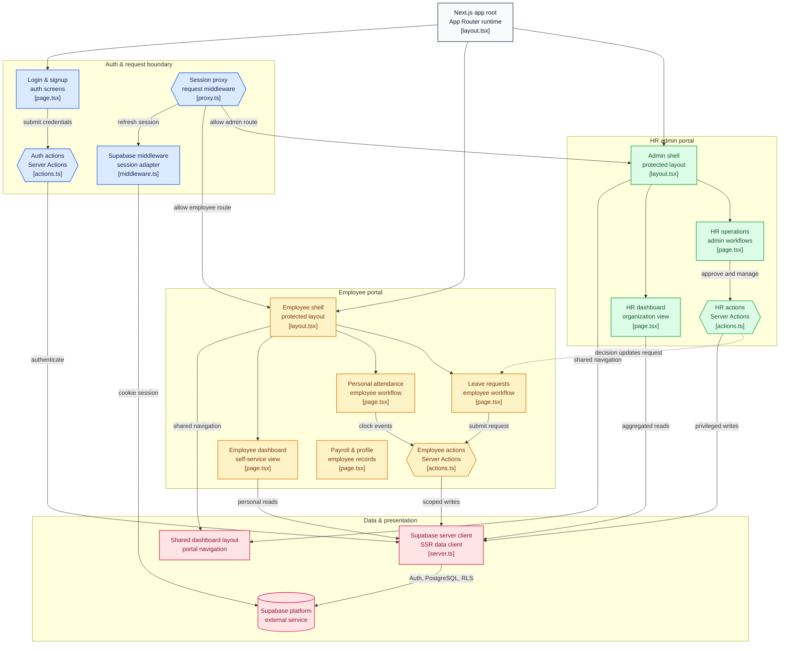

# Dayflow — Enterprise Human Resource Management System

<p align="center">
  <strong>Every workday, perfectly aligned.</strong>
  <br />
  A modern HRMS for secure, streamlined workforce operations.
  <br /><br />
  <a href="https://github.com/ritam-05/dayflow-hrms"></a>
  <a href="https://www.typescriptlang.org/"></a>
  <a href="https://tailwindcss.com/"></a>
  <a href="https://supabase.com/"></a>
  <a href="https://vercel.com/"></a>
</p>

---

## Overview

**Dayflow** is a role-based Human Resource Management System designed to simplify everyday HR operations through dedicated employee and HR administrator portals.

The application brings together authentication, attendance tracking, leave management, employee records, and payroll views in one interface. Its architecture uses Supabase for authentication and data storage, with access boundaries enforced through application-level route protection and PostgreSQL Row Level Security.

## Table of Contents

- [Core Features](#core-features)
- [Technology Stack](#technology-stack)
- [Application Architecture](#application-architecture)
- [Local Development](#local-development)
- [Deployment](#deployment)
- [Planned Enhancements](#planned-enhancements)
- [Project Structure](#project-structure)

---

## Core Features

### 1. Authentication & Role-Based Access Control

- **Dual portals:** Separate routing and user experiences for Employee and HR / Admin roles.
- **Protected HR onboarding:** HR account creation requires a server-side `ADMIN_SECRET` to help prevent privilege escalation.
- **Persistent sessions:** Supabase Auth session handling with HTTP-only cookies and Next.js request routing guards.

### 2. Role-Specific Dashboards

| Employee Dashboard | HR Dashboard |
| --- | --- |
| Quick-access Profile, Attendance, and Leave metrics | Organization-level overview metrics |
| Current attendance status indicators | Employee counts |
| Recent activity and notification feed | Pending leave request tracking |

### 3. Attendance Management

- **Employee view:** Daily check-in and check-out with timestamp logging and current-day status indicators.
- **Admin view:** Company-wide daily attendance logs for workforce monitoring.

### 4. Leave & Time-Off Management

- **Employee self-service:** Submit leave requests with a leave type (Paid, Sick, or Unpaid), date range, and optional remarks.
- **Request history:** Employees can review their submitted leave applications.
- **HR review pipeline:** Administrators can review, approve, or reject pending leave requests across the organization.

### 5. Employee Profiles & Payroll

- **Profiles:** Employees can view their registered information; administrators can access the employee directory.
- **Employee payroll view:** Read-only compensation history and mock PDF payslip views.
- **HR payroll controls:** An administrative interface for managing organizational salary structures.

---

## Technology Stack

| Layer | Technology |
| --- | --- |
| Framework | [Next.js 16](https://nextjs.org/) — App Router, Server Actions, Turbopack |
| Language | TypeScript |
| Styling | [Tailwind CSS v4](https://tailwindcss.com/) |
| UI Components | [shadcn/ui](https://ui.shadcn.com/) |
| Icons | Lucide React |
| Database | [Supabase](https://supabase.com/) — PostgreSQL |
| Authentication | Supabase Auth |
| Data security | PostgreSQL Row Level Security (RLS) |
| Deployment | [Vercel](https://vercel.com/) |

---

## Application Architecture

The application separates authentication and session handling from the employee and HR workflows. Both portals use a shared dashboard shell and communicate with Supabase through the server-side data client.



---

## Local Development

Follow these steps to run Dayflow locally.

### Prerequisites

- Node.js and npm
- A Supabase project
- Git

### 1. Clone the repository

```bash
git clone https://github.com/ritam-05/dayflow-hrms.git
cd dayflow-hrms
```

### 2. Install dependencies

```bash
npm install
```

### 3. Configure environment variables

Create a `.env.local` file in the project root and add your Supabase project credentials and the HR onboarding secret:

```env
NEXT_PUBLIC_SUPABASE_URL=your_supabase_project_url
NEXT_PUBLIC_SUPABASE_ANON_KEY=your_supabase_anon_key
ADMIN_SECRET=replace_with_a_strong_private_secret
```

> **Security note:** Keep `ADMIN_SECRET` private. Do not commit `.env.local` or expose this value through client-side code. Use a strong, unique secret in each environment.

### 4. Start the development server

```bash
npm run dev
```

Open [http://localhost:3000](http://localhost:3000) in your browser. The application will direct unauthenticated visitors to the login screen.

---

## Deployment

Dayflow is configured for deployment on [Vercel](https://vercel.com/).

1. Push the project to a GitHub repository.
2. Sign in to Vercel and select **Add New Project**.
3. Import the Dayflow repository.
4. Add the following environment variables in the project settings:

   - `NEXT_PUBLIC_SUPABASE_URL`
   - `NEXT_PUBLIC_SUPABASE_ANON_KEY`
   - `ADMIN_SECRET`

5. Deploy the project.

Vercel will build and deploy the application, then provide a production URL.

---

## Planned Enhancements

The current MVP provides the core HR workflows. The following enhancements are planned for future iterations:

| Enhancement | Planned capability |
| --- | --- |
| **Analytics dashboard** | Recharts visualizations for attendance trends and leave distributions. |
| **Automated PDF generation** | Generate and email actual payroll slips using react-pdf. |
| **Bulk onboarding** | CSV-based employee import for organization-wide onboarding. |
| **Shift scheduling** | Calendar-based assignment of employee shifts and working hours. |
| **Email notifications** | Resend / SendGrid webhook integrations for leave approval and rejection updates. |

---

## Project Structure

```text
dayflow-hrms/
├── app/
│   ├── (auth)/             # Authentication routes (Login, Signup)
│   ├── admin/              # HR-exclusive routes
│   │   ├── attendance/     # Global attendance logs
│   │   ├── dashboard/      # HR metrics overview
│   │   ├── employees/      # Company-wide personnel directory
│   │   ├── leave/          # Leave request approval queue
│   │   └── payroll/        # Salary structure management
│   ├── employee/           # Employee-exclusive routes
│   │   ├── attendance/     # Personal clock-in/out
│   │   ├── dashboard/      # Personal overview & alerts
│   │   ├── leave/          # Leave application form & history
│   │   ├── payroll/        # Salary history & slips
│   │   └── profile/        # Personal details view
│   ├── auth/               # Server actions for Supabase Auth handling
│   ├── layout.tsx          # Root layout & global font configuration
│   └── globals.css         # Tailwind directives & custom scrollbars
├── components/
│   ├── layout/             # Application shell, responsive sidebar, headers
│   └── ui/                 # Reusable shadcn/ui primitives
├── lib/
│   └── supabase/           # Supabase SSR client configurations
└── middleware.ts           # Edge middleware for route protection & redirects
```

---

<p align="center">
  Built with Next.js, TypeScript, Tailwind CSS, and Supabase.
  <br />
  <a href="https://github.com/ritam-05/dayflow-hrms">View repository</a>
</p>
